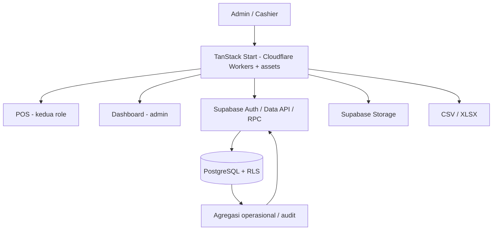

# Coffee Shop POS — Technical Stack & Architecture Plan

> **Versi:** 1.2 · **Tanggal:** 17 Oktober 2026 · **Deployment:** TanStack Start + Cloudflare Workers + BaaS · **Target biaya awal:** free tier
> **Acuan produk:** [PRD.md](./PRD.md) · **Desain:** [UI-UX-GUIDELINES.md](./UI-UX-GUIDELINES.md)

## 0. Batas implementasi

- Tepat dua role `admin` dan `cashier`, dua halaman utama `/pos` dan `/dashboard`.
- Admin dapat memakai keduanya; cashier hanya POS, termasuk Monitor dengan laba agregat.
- Login/state sistem adalah pendukung; modul lain memakai tab/panel/modal dan query params, bukan route mandiri.
- Pertahankan **TanStack Start**, React, Supabase, adapter Cloudflare Workers, BoardUI Free, CSV/XLSX. Vite tetap menjadi build/dev tooling TanStack Start, bukan alasan mengubah aplikasi menjadi React/Vite SPA standalone. Tidak menambah backend/ORM terpisah, inventory atau akuntansi penuh.
- Source of truth uang dan status order ada di PostgreSQL. Browser tidak dapat menulis payment/gerak uang secara langsung.
- Simpan order wajib; shift, closing bulanan dan approval berlapis tidak menjadi dependensi MVP.
- Detail aturan bisnis dan rumus mengikuti PRD, termasuk snapshot, tanggal bayar, kategori pengeluaran, refund, serta koreksi.

## 1. Keputusan teknologi

| Layer | Pilihan | Alasan | Hindari di MVP |
|---|---|---|---|
| Runtime UI | TanStack Start + React 19 + TypeScript | File-based routing, client navigation; rendering dapat dipilih | Mengganti framework untuk mengatasi bug navigasi/layout |
| Route | TanStack Router | File-based type-safe routes, nested layouts, route guards | Routing manual tanpa typing |
| Fetch/cache | TanStack Query | Cache, invalidation, retry query | Mengandalkan Zustand untuk server data |
| Client state | React state; Zustand **hanya jika perlu** untuk draft cart | Sederhana | Menjadikan Zustand DB kedua |
| Styling | Tailwind CSS v4 | BoardUI-compatible | UI framework campuran tanpa kebutuhan |
| UI system | BoardUI Free components and tokens | Konsistensi visual | Menyalin BoardUI Pro tanpa lisensi |
| Charts | Recharts | Grafik fleksibel dan bebas biaya | Chart premium wajib bayar |
| Forms | React Hook Form + Zod | Validasi UI dan typing | Menganggap validasi client cukup |
| Backend | Supabase Auth + Postgres + Data API + RPC | Tidak perlu backend standalone | Memasang ORM/REST server ganda |
| DB | PostgreSQL hosted Supabase Free | Relasional, transaksi ACID | SQLite browser sebagai source of truth |
| Auth | Supabase email/password | Role-based access, session | Signup publik |
| Files | Supabase Storage | Foto produk/bukti transaksi | Menyimpan base64 images di DB |
| Exports | CSV utilities + ExcelJS (browser dynamic import) | CSV & native XLSX | Pseudo `.xlsx` berbentuk CSV |
| Dates | `date-fns` + `date-fns-tz` **atau** standar JS Temporal polyfill jika dibutuhkan | WIB / UTC robust | Menggunakan browser locale tanpa eksplisit zone |
| Hosting | Cloudflare Workers + static assets melalui adapter yang sudah terpasang | Sesuai `vite.config.ts`, `wrangler.jsonc`, dan server entry TanStack Start | Mengunggah output Start sebagai SPA static biasa tanpa evaluasi |
| Package manager | npm untuk workspace saat ini (`package-lock.json`) | Reproducible lockfile; gunakan `npm ci` | Berganti-ganti manager/menulis ulang lockfile dalam pekerjaan UI |
| Tests | Vitest + React Testing Library + Playwright | Unit, integration, e2e | Menerima demo tanpa tes finansial |
| DB migrations | Supabase CLI migrations | Versioned schema & RPC | SQL manual di production tanpa version control |

**Keputusan rendering:** workspace sudah menggunakan TanStack Start. Saat audit, root route memakai `ssr: false`, sehingga komponen halaman dirender di browser, tetapi build tetap memiliki server entry/adapter Start. Ini bukan migrasi ke framework lain dan bukan otomatis mode static SPA. Untuk dashboard/POS privat, pertahankan client rendering terlebih dahulu; SSR selektif baru dievaluasi bila metrik initial load production menunjukkan kebutuhan. SSR tidak menggantikan client navigation, code splitting, cache data, atau perbaikan layout. [Selective SSR](https://tanstack.com/start/latest/docs/framework/react/guide/selective-ssr).

**Prioritas kecepatan:** gunakan `Link` TanStack Router untuk navigasi internal dan preload berbasis intent; jangan membuat reload dokumen untuk berpindah menu. Settings/modul sekunder dimuat dinamis; devtools hanya aktif saat development dengan `VITE_DEVTOOLS=true`. Ukur development cold start, production initial load, dan perpindahan menu secara terpisah. Hasil localhost tidak menjamin performa jaringan/server production. [Preloading](https://tanstack.com/router/latest/docs/framework/react/guide/preloading).

### 1.1 BoardUI install resmi

Dokumentasi BoardUI saat penulisan: https://www.boardui.com/getting-started dan https://github.com/BoardUI/boardui. Vendor menggunakan **React + Tailwind CSS v4** dan menyediakan command:

```bash
# Workspace sudah memakai TanStack Start + BoardUI. Jangan scaffold ulang.
npm ci
npm run dev
# Cek komponen terpasang dan BoardUI MCP sebelum menambah komponen:
npx boardui@latest add <nama-komponen-free-terverifikasi>
```

> Versi paket mengikuti lockfile dan kompatibilitas TanStack Start/BoardUI. Tabel di atas juga memuat rencana integrasi; paket seperti Supabase, ExcelJS dan test runner belum otomatis terpasang. Jangan menjalankan CLI BoardUI dengan mengasumsikan template Pro termasuk paket Free.

### 1.2 Mengapa bukan Neon pada MVP?

Neon kuat sebagai PostgreSQL, tetapi Supabase sudah memberikan Auth, Data API, Storage, dan policy model RLS yang bisa diakses aman dari CSR. Dengan Neon, perlu lapisan API/auth tambahan untuk POS. Jika kebutuhan berubah, data SQL standar dapat dimigrasikan, namun Auth/Storage/RLS tergantung integrasi Supabase.

---

## 2. Arsitektur dan otorisasi



Browser hanya memiliki URL Supabase dan publishable key. Rahasia service-role, DB password dan admin Auth tidak masuk bundle. Role berasal dari `profiles` yang terlindungi, bukan user-editable metadata. Semua RPC memeriksa `auth.uid()`, profile aktif, role, dan satu `store_id`.

### 2.1 Batas akses data

| Data/operasi | Admin | Cashier |
|---|---|---|
| Katalog dan order seluruh toko | Baca; kelola master | Baca; mutasi unpaid/bayar via RPC |
| Pengeluaran/pemasukan seluruh toko dan bukti | Baca, input, koreksi | Baca, input hari ini; tanpa koreksi |
| Report POS: penjualan, produk, laba agregat | ✓ | ✓ |
| `product_costs`, `order_item_costs` | Baca/kelola sesuai kontrak | Tidak SELECT langsung |
| Report audit, margin produk, buku kas mentah | ✓ | — |
| Refund, perubahan role, pengaturan | ✓ | — |

Pisahkan HPP master ke `product_costs`, snapshot HPP ke `order_item_costs`. Report Monitor mengembalikan angka HPP/laba **agregat** yang diizinkan, bukan tabel biaya/item margin. Jangan memberi report POS parameter bebas untuk memilih tabel/kolom, mengaktifkan mode audit, atau filter produk/kasir untuk menurunkan rincian biaya. Rincian margin produk hanya RPC admin. Perbedaan ini bukan pembatasan laba agregat kasir.

Cashier boleh membaca semua order dan daftar uang masuk/keluar dalam outlet agar pergantian kasir lancar. Keamanan tidak memakai scope `created_by = auth.uid()` untuk daftar operasional. Nama pelanggan/meja cukup label singkat; jangan mengumpulkan profil pelanggan yang tidak dibutuhkan.

### 2.2 RPC yang melakukan transaksi

Gunakan facade public `SECURITY INVOKER` dan implementasi privileged di schema `private` yang tidak diekspos Data API, dengan `SECURITY DEFINER`, `search_path = ''`, identifier fully qualified, grants minimum, dan otorisasi di setiap entry point. Revoke execute default dari `PUBLIC`/`anon`; grant authenticated hanya untuk fungsi yang memang dipakai. Implementasi private tetap memeriksa izin ketika dapat dipanggil role authenticated melalui facade.

Kunci direct DML client pada orders/items/cost snapshots/payments/refunds/expenses/other_inflows/cash_movements/audit_logs. Mutasi lewat RPC agar validasi, status, histori dan gerak uang atomik. CRUD master juga memeriksa role admin. Kontrak SQL/JSONB harus typed atau divalidasi ketat; ini rancangan, bukan migration siap produksi.

## 3. Struktur frontend dan navigasi

```text
src/
  app/                 # providers, config
  routes/
    __root.tsx
    login.tsx
    _protected.tsx
    _protected.pos.tsx
    _protected.dashboard.tsx
  components/
    boardui/           # komponen free dan token
    layout/            # shell dua halaman dan menu internal
    shared/            # filter, tabel, money, export, receipt
    charts/
  features/
    auth/
    pos/               # kasir, tersimpan, penjualan, monitor
    orders/            # komponen/query; bukan halaman route baru
    products/
    promotions/
    finance/           # pemasukan/pengeluaran/buku kas
    reports/
    settings/
  lib/                 # supabase, permissions, money, date-range, export
  types/database.types.ts
supabase/
  migrations/
  seed.sql
  tests/
e2e/
```

Pakai repository `api.ts`, query hooks/keys `queries.ts`, schemas Zod, dan komponen per feature. Route guard menunggu profile selesai dimuat; cashier membuka Dashboard diarahkan ke POS. Backend tetap menolak query admin.

Query params terverifikasi: `menu`, `tab`, `period`, `from`, `to`, `order`, filter yang diizinkan. Enum menu terpisah untuk POS/Dashboard. Invalid params kembali ke default aman. Detail dan form berupa drawer/modal pada halaman yang sama. Keranjang ditempatkan di state POS di atas menu, tidak hilang saat ganti menu. Draft lokal belum tersimpan tidak boleh dilabeli sebagai order tersimpan di server.

## 4. Skema data minimum

### 4.1 Konvensi

- UUID untuk ID internal, nomor order unik yang mudah dibaca untuk operasional.
- Uang `bigint`/integer IDR dan constraint valid; nilai aggregate yang melewati safe integer JS di-parse dengan aman.
- Waktu `timestamptz` UTC; business date WIB dari server. Satu store, tanpa UI multi-outlet.
- Keuangan/audit tidak hard delete; master nonaktif tetap dapat dibaca pada histori.
- Harga/HPP item snapshot, tidak dihitung ulang dari master untuk order yang sudah disimpan.

### 4.2 Tabel

| Tabel | Data dan aturan inti |
|---|---|
| `stores` | Identitas, WIB/IDR, footer struk; satu outlet |
| `profiles` | FK Auth, store, nama, role `admin/cashier`, aktif; client tidak dapat menaikkan role sendiri |
| `categories` | Nama unik per store, urutan, aktif |
| `products` | Kategori, nama, harga >0, foto opsional, aktif/tersedia; admin write |
| `product_costs` | Produk, HPP estimasi ≥0, updater/waktu; admin-only raw access |
| `promotions` | Kode unik, persen/fixed, periode, batas minimum/diskon/pemakaian, aktif |
| `orders` | Nomor, store, `created_by`, `updated_by`, `paid_by` nullable, label pelanggan/meja, notes, `status`, `version`, subtotal/diskon/total, created/updated/paid timestamps, `paid_business_date` nullable |
| `order_items` | Order, product ID, snapshot nama/kategori/harga, qty >0, diskon teralokasi, subtotal/net line, catatan; editable hanya saat unpaid |
| `order_item_costs` | Item ID, HPP unit/total snapshot; admin raw read, RPC write |
| `payments` | Order unik, metode, nominal, uang diterima/kembalian, akun tujuan, verifikator manual, paid timestamp/business date |
| `refunds` | Order unik, payment, nilai penuh, akun asal, alasan, pencatat/waktu/business date |
| `financial_accounts` | CASH, BANK_QRIS; saldo awal, aktif; saldo buku, bukan saldo bank terverifikasi |
| `expense_categories` | Nama, default rule `stock_purchase`/`operating_expense`, aktif |
| `expenses` | Store, kategori dan rule snapshot, nominal, akun, tanggal bisnis, keterangan, bukti opsional, posted/reversed, pencatat, reversal actor/time/reason |
| `other_inflows` | Store, tambahan modal/lainnya, nominal, akun, tanggal bisnis, keterangan, bukti, posted/reversed, pencatat dan reversal metadata |
| `cash_movements` | Akun, sumber/ID, arah +/−, nilai, business date, waktu, pencatat, referensi reversal; append-only |
| `operation_requests` | Store, request key unik, actor, operation, payload hash, entity/result ref; tersimpan dalam transaksi yang sama |
| `audit_logs` | Actor, entity, action, waktu, alasan/metadata aman; tidak memuat token/password |

Status order: `unpaid → paid → refunded` atau `unpaid → cancelled`. Transaksi langsung dapat membuat `paid` secara atomik. Tidak ada partial paid, partially refunded, kitchen status, atau field shift wajib. `paid_business_date` null untuk unpaid/cancelled. Payments/refunds unik per order.

`operation_requests` dipakai untuk idempotensi simpan/ubah/bayar/refund/input uang/koreksi. Key sama + payload/operasi sama mengembalikan hasil yang sama setelah otorisasi; key sama dengan payload/operasi berbeda ditolak. Unique constraint dan transaksi mencegah race. Jangan hanya mengandalkan disable tombol.

### 4.3 Indeks dan batasan

- `orders(store_id, paid_business_date, paid_at)` untuk penjualan; `orders(store_id, status, created_at)` untuk semua unpaid termasuk lintas hari.
- Unique nomor order per store; index item per order/product; unique payment per order dan refund per order.
- `operation_requests(store_id, request_key)` unique, menyimpan actor dan payload hash canonical dari request.
- `expenses/other_inflows(store_id, business_date)` dan tanggal reversal untuk report event; `cash_movements(account_id, business_date, posted_at, id)`.
- Harga >0, HPP ≥0, qty integer 1..99, 1..30 baris per order sebagai batas awal wajar; total selalu dihitung DB.
- Profil/kategori/produk/promo menyimpan store scope; unique nama/kode dinormalisasi. Data finansial tidak dapat dihapus via browser.

## 5. Kontrak transaksi dan konkurensi

### 5.1 RPC minimum

| Operasi | Kontrak utama | Akses |
|---|---|---|
| `preview_order` | Hitung draft atau tagihan saved, return quote/version | Kedua role |
| `save_order` | Buat unpaid baru atau ubah unpaid dengan expectedVersion | Kedua role |
| `cancel_order` | Lock unpaid, alasan, expectedVersion | Kedua role |
| `checkout_order` | Draft baru atau saved order ID, quote, metode, request key | Kedua role |
| `refund_order` | Paid order, alasan, konfirmasi uang kembali | Admin |
| `post_expense` / `post_other_inflow` | Nominal/kategori/akun/keterangan/tanggal | Kedua role; tanggal cashier hari ini |
| `reverse_expense` / `reverse_other_inflow` | ID catatan, alasan, request key | Admin |
| RPC master/settings | Payload tervalidasi | Admin |

Semua mutasi memiliki request key. Server menurunkan actor/store sendiri; tanggal cashier divalidasi ulang terhadap hari WIB server. Bila melewati tengah malam sebelum submit, minta kasir meninjau tanggal hari baru. Admin dapat backdate input awal dengan alasan; refund/reversal memakai tanggal aksi server.

### 5.2 Simpan dan ubah unpaid

1. Validasi auth/profile/store, request key, item, label pelanggan/meja.
2. Create: validasi produk aktif/tersedia, ambil harga/HPP master dan snapshot. Tidak membuat payment/cash movement atau memakai kuota promo.
3. Update: lock order `FOR UPDATE`, wajib unpaid dan version cocok. Item lama diidentifikasi dengan `orderItemId` milik order; pertahankan harga/HPP snapshot, termasuk saat qty berubah. Item baru tanpa ID memakai master terkini dan ketersediaan.
4. Hitung ulang subtotal/preview diskon, simpan perubahan, increment version, audit. Snapshot biaya tidak dikirim ke cashier.
5. Commit lalu return order ID/number/version/total/status unpaid. Timeout di-retry dengan request key sama; tidak membuat order tambahan.

Produk lama yang sudah disimpan boleh dibayar meski kemudian nonaktif/habis; penambahan item baru tetap divalidasi. Jika harga berbeda antara snapshot lama dan tambahan baru produk yang sama, pertahankan baris harga berbeda; laporan tetap mengelompokkan product ID.

### 5.3 Preview dan pembayaran

`preview_order` mengembalikan rincian quote server dan token/hash quote yang terikat actor/store, item/versi, harga snapshot/master sesuai jenis order, promo dan total. `checkout_order` menghitung ulang dan memastikan quote yang disetujui masih sama. Beda quote → return `QUOTE_CHANGED` + preview terbaru, **tanpa** posting; UI meminta persetujuan ulang. Token quote bukan sumber harga tepercaya tanpa validasi server.

Langkah checkout atomik:

1. Auth/profile/store/request-key check. Jika saved order: lock, cek unpaid + expectedVersion; ambil item/snapshot tersimpan. Jika draft langsung: validasi katalog dan ambil snapshot terbaru.
2. Hitung subtotal, promo yang masih berlaku/kuota tersedia, alokasikan diskon ke line secara deterministik hingga jumlah persis sama dengan diskon order. Reservasi kuota hanya pada pembayaran sukses, dengan lock/conditional update.
3. Cocokkan quote; validasi metode, nominal tendered dan verifikasi manual QRIS/transfer. Tidak menerima total/HPP buatan client sebagai nilai final.
4. Saved: update order yang sama menjadi paid; draft: create paid. Simpan `paid_by`, paid_at/business_date, payment unik, cash movement **sebesar tagihan**, audit, operation result dalam transaksi yang sama.
5. Commit, return receipt. Error rollback semua. Retry dengan key sama mengembalikan order sama; key lain untuk order yang sudah dibayar ditolak sebagai `ALREADY_PAID` dengan detail aman.

Race bayar/bayar, ubah/bayar, batal/bayar diselesaikan row lock + expectedVersion + constraint, bukan last-write-wins. Order unpaid tetap lintas logout/hari/kasir. Daftar unpaid tidak memakai filter default hari ini yang menyembunyikan tagihan lama.

### 5.4 Refund dan input uang

**Refund:** admin-only, lock order paid, unique refund/order, amount dari payment, akun asal, alasan dan manual funds-returned confirmation. Tulis refund + cash out + status refunded + audit/result atomik. Report membalik penjualan/HPP snapshot pada tanggal refund. UI cukup satu konfirmasi; tidak ada jurnal atau periode yang dipilih user.

**Expense:** simpan kategori/rule snapshot dari DB, nominal, akun, keterangan, bukti dan tanggal tervalidasi; tulis expense + cash out + audit/result atomik. Bahan/kemasan `stock_purchase` tidak menambah operating expense karena HPP per porsi sudah dihitung.

**Other inflow:** kedua role boleh input, cash in bertambah; semua kategori manual tidak menambah sales/profit MVP. Pembayaran order tidak boleh diinput ulang di sini.

**Koreksi:** admin membatalkan catatan posted dengan alasan, lock dan unique reversal; buat cash movement berlawanan pada tanggal aksi, status reversed + metadata audit. Report tetap menyertakan event asli di tanggal asal dan event reversal di tanggal koreksi, termasuk pembalikan operating expense bila relevan. Jangan memakai `WHERE status='posted'` saja untuk histori. Catatan pengganti adalah input baru. Tidak ada approval workflow atau edit angka historis diam-diam.

## 6. Query/report dan cache

### 6.1 RPC report dengan cakupan eksplisit

```text
report_pos_sales(from_date, to_date, group_by, status_or_method_filters)
report_pos_products(from_date, to_date, sort_by)          # qty/revenue, tanpa HPP item
report_pos_monitor(from_date, to_date)                    # laba agregat toko
get_unpaid_orders(search, cursor)                         # semua tanggal
list_expenses/list_other_inflows(from_date, to_date, filters)
report_admin_finance(from_date, to_date)                  # admin-only
report_admin_item_margins(from_date, to_date, filters)    # admin-only
report_admin_cash_flow(from_date, to_date, account_id)   # admin-only
report_admin_audit(from_date, to_date, filters)           # admin-only
```

- UI POS/Dashboard memakai SQL definition yang sama untuk metrik setara. Dashboard menambahkan detail/filter, bukan formula baru.
- Sale events dari pembayaran tanggal bayar; refund dari tanggal refund. Cancelled/unpaid tidak masuk sales, COGS, laba, best seller.
- Semua total histori menyertakan sale yang sekarang berstatus refunded; jangan hanya menjumlah `orders.status='paid'`.
- Report expense/inflow memakai event posting dan reversal masing-masing tanggal; rule kategori snapshot tidak berubah ketika master kategori diubah.
- Pending count/value merupakan kondisi **saat ini semua tanggal**, terpisah dari date-range metrics. Label ini ada pada response/UI.
- Header POS revenue hari ini memakai query hari ini tersendiri; tidak ikut berubah saat filter Monitor/Penjualan diganti.
- Rekap produk menggunakan product ID stabil, nama display dan nama snapshot tersedia untuk detail. Produk nonaktif tetap ada di histori.
- Preset WIB, periode, AOV dan diskon mengikuti PRD §7. Gunakan SQL agregasi/indeks, bukan sum semua baris di React.

### 6.2 Kontrak frontend ilustratif

```ts
type Role = 'admin' | 'cashier'
type OrderStatus = 'unpaid' | 'paid' | 'cancelled' | 'refunded'
type PaymentMethod = 'cash' | 'qris_manual' | 'bank_transfer_manual'
type ItemInput = {
  productId: string
  orderItemId?: string // hanya item lama; server periksa milik order
  quantity: number
  note?: string
}
type OrderDraft = {
  items: ItemInput[]
  customerOrTableLabel?: string // wajib untuk save, opsional bayar langsung
  notes?: string
  promotionCode?: string
}
type SaveOrderInput = OrderDraft & {
  orderId?: string
  expectedVersion?: number // wajib bila update
  requestKey: string
}
type CheckoutSource =
  | { kind: 'draft'; draft: OrderDraft }
  | { kind: 'saved'; orderId: string; expectedVersion: number }
type CheckoutInput = {
  source: CheckoutSource
  quoteToken: string
  paymentMethod: PaymentMethod
  amountTenderedIdr?: number
  manuallyVerified?: boolean
  requestKey: string
}
type DateRange = { from: string; to: string } // tanggal bisnis YYYY-MM-DD
type ReportGroup = 'day' | 'week' | 'month' | 'year'
```

### 6.3 Cache dan refresh

Query keys menyertakan store/user/role, feature, periode/filter dan pagination. Hapus seluruh cache sensitif saat logout/role berubah. Setelah save/update/cancel: invalidasi unpaid, detail, badge dan pending monitor; setelah bayar/refund: juga sales, produk, revenue hari ini, Monitor/Dashboard dan finance; setelah input/reversal uang: daftar terkait, Monitor, keuangan dan saldo buku.

Refetch saat window focus, refresh manual dan staleTime pendek 30–60 detik. Tampilkan last-updated. Tidak memerlukan Realtime MVP. Local cart tersimpan terpisah dari server order dan dibersihkan setelah sukses/logout, bukan sebelum server merespons.

## 7. Ekspor

- Report rows berasal dari query aman yang sama dengan layar, semua halaman diambil dengan cursor stabil; jangan terkena default row limit Supabase.
- Cashier hanya ekspor penjualan/rekap produk/periode POS, tidak dataset audit/HPP mentah. Server memeriksa jenis report, bukan percaya tombol UI.
- CSV RFC4180, UTF-8 BOM, CRLF; angka tanpa Rp/titik ribuan, tanggal ISO dan WIB jelas. Escape formula-leading user text; angka negatif tetap angka.
- ExcelJS dynamic import saat ekspor; file `.xlsx` asli dengan numeric cells, format Rupiah, string user dipaksa text, freeze header/autofilter dan lebar kolom.
- Sheet `Ringkasan`/`Detail` jika relevan; cantumkan periode, timezone dan definisi laba estimasi. Jangan menyisipkan data terlarang pada hidden sheet.
- Batas awal 50.000 baris/export; minta perkecil rentang jika melebihi. Export server/background P1 bila volume menuntut.
- Validasi jumlah laporan/UI/ekspor dengan fixture yang sama. File laporan bukan backup database.

## 8. Supabase Free deployment and environment

### 8.1 Database project

1. Create one Supabase project for production; a separate local DB instance using Supabase CLI for development/tests.
2. Put SQL migrations in Git and run in order.
3. Create initial `stores`, categories, financial accounts, `expense_categories` via seed/bootstrap migration.
4. Create Admin Auth user via safe admin/bootstrap process, then manually create `profiles` entry. Disable public sign-up in production.
5. RLS `ENABLE` on all exposed tables, grant only minimum operations, test via anon, admin, cashier.
6. Configure storage buckets `product-images` (public-read permitted if only products) and `expense-proofs` (private, read admin/cashier dalam outlet; upload sesuai pembuat catatan); never create public URL for private proof.
7. Configure allowed origin/redirect URLs for Supabase Auth (domain production Cloudflare + local dev; preview domains only when necessary).
8. Setup monitoring for database storage, error rate, and inactivity; free projects may pause under inactivity and do not have built-in managed backups.

### 8.2 Environment variables

```dotenv
# .env.example — browser-visible values only, never include production secrets
VITE_SUPABASE_URL=https://example.supabase.co
VITE_SUPABASE_PUBLISHABLE_KEY=sb_publishable_example
VITE_APP_NAME=Coffee Shop POS
# Optional development tools; default off, not required for the UI
VITE_DEVTOOLS=false
```

**Strictly forbidden in frontend:** `SUPABASE_SERVICE_ROLE_KEY`, Supabase secret key, DB connection string/password, storage S3 secret, payment gateway API secret.

### 8.3 Cloudflare Workers deployment (TanStack Start)

1. Push repo to GitHub.
2. Gunakan konfigurasi Cloudflare Vite plugin dan Wrangler yang sudah ada; jangan menggantinya dengan preset static Vite/Pages.
3. Install `npm ci`, verifikasi `npx tsc --noEmit`, lalu `npm run build`. Output mencakup `dist/client` dan `dist/server`; bukan hanya static `dist`.
4. Use supported Node version in Cloudflare build environment; pin in `.node-version` / config if necessary.
5. Set `VITE_SUPABASE_URL` dan `VITE_SUPABASE_PUBLISHABLE_KEY` pada build environment; secret server tidak memakai prefiks `VITE_`.
6. Uji `npm run preview` secara lokal, termasuk refresh/deep links `/login`, `/dashboard`, `/pos?view=simpan-pesanan`. Gunakan routing Start/server entry yang dibangun, bukan menambahkan fallback SPA secara sembarang.
7. Setelah approval deployment, jalankan workflow `npm run deploy` yang sudah tersedia untuk target staging dahulu; verifikasi domain/config/bindings sebelum production.
8. Verify login, DB policies, images and exports on production domain. [Panduan resmi TanStack Start di Cloudflare Workers](https://developers.cloudflare.com/workers/framework-guides/web-apps/tanstack-start/).

### 8.4 Free-tier capacity assumptions

- 40 products, 1–3 cashiers, dozens/hundreds of orders/day are **likely feasible** but not guaranteed by product count alone.
- Deployment saat ini menggunakan Worker/server entry TanStack Start meskipun komponen memakai client rendering; pantau request, CPU, asset caching, dan batas plan yang dipilih. Jangan menganggap penggunaan Worker nol.
- Supabase Free database and Storage quotas are finite; index/ledger grow with order volume. Check current plan limits at https://supabase.com/pricing and https://developers.cloudflare.com/pages/platform/limits/ rather than hardcode long-term figures.
- Supabase Free may pause inactive projects; production POS needs a recovery/backup plan. If recordkeeping becomes business-critical, be prepared to move to a paid DB or self-managed backup strategy.

---

## 9. Backups, export DB & disaster recovery

**Required for POS even on free tier.** CSV report downloads **are not** database backups; they do not fully restore relationships/auth/schema.

### 9.1 Backup jobs

- Use Supabase CLI `supabase db dump` / PostgreSQL `pg_dump` from trusted dev machine/secure CI with secrets stored in secure CI, **not browser**.
- Dump schema and data at least daily; consider twice daily for active cash transactions. Retain rolling 7 daily + 4 weekly backups (adapt storage cost and security).
- Encryption at rest and limited access for backups; do not store plaintext prod DB in public Git.
- Export `product-images` and `expense-proofs` separately; database dump does not include binary Storage objects.
- Supabase Auth-related backup/restore behavior must be documented/tested: do not assume a basic `public` dump automatically restores every Auth configuration and user identity.
- Test restore **monthly** to a separate nonproduction project; reconcile record counts, totals, auth, image links.
- Monitor job failures; manual backup by admin is fallback only, not primary reliability strategy.

### 9.2 Failures

| Failure | UX / mitigation |
|---|---|
| Internet down | Mark offline, checkout disabled; fallback manual log outside application |
| Supabase unavailable | Alert + safe error; never claim paid; admin reconciles manual transactions after recovery |
| Checkout timeout | Fetch by idempotency key; retry same key, never random new key blindly |
| Storage image error | Product placeholder; checkout still usable |
| Analytics error | Show error with retry; don't fake zero totals as real |
| Database near quota | Admin warning; backup + upgrade/migrate before read-only state |
| User revoked | RLS/RPC deny regardless of old browser session |

---

## 10. Verifikasi implementasi

### 10.1 Otorisasi

- Anonymous dan profile nonaktif tidak bisa membaca data internal atau menjalankan mutasi.
- Cashier dapat membaca seluruh order/daftar uang toko dan Monitor agregat, termasuk laba.
- Cashier tidak dapat membuka Dashboard, mengakses raw costs/margin produk/buku kas/audit report atau ekspornya, mengubah master/role, backdate, reverse atau refund.
- Mencoba direct DML payment/order/ledger ditolak; memanggil RPC tetap memvalidasi role dan state.
- Private Storage bukti mengikuti izin toko dan ukuran/MIME; tidak ada public URL untuk bukti.
- Admin CRUD/settings/refund berjalan; cache logout tidak membocorkan data ke sesi berikutnya.

### 10.2 Transaksi dan laporan

| Skenario | Hasil yang diharapkan |
|---|---|
| Simpan kopi lalu logout; kasir lain masuk besok | Order unpaid yang sama ditemukan dan dapat dilanjutkan |
| Unpaid berisi 6 kopi | Pendapatan/unit/best seller belum bertambah |
| Bayar order kemarin hari ini | Paid date hari ini; order ID sama, satu payment dan movement |
| Dua kasir bayar/batal/ubah order bersamaan | Satu transisi valid, yang lain mendapat konflik tanpa posting ganda |
| Harga/HPP master berubah | Item saved tetap snapshot; item baru pakai master baru; quote berubah perlu konfirmasi |
| Klik dua kali/retry setelah timeout | Hasil sama, satu posting; key sama beda payload ditolak |
| Tunai 30rb, diterima 50rb | Movement +30rb, kembali 20rb |
| Tambahan modal 100rb | Kas +100rb, omzet/laba tidak bertambah |
| Beli susu 100rb | Total pengeluaran +100rb, kas -100rb, operating expense tidak bertambah |
| Sewa 2jt | Kas -2jt, biaya operasional +2jt |
| Refund order bulan lalu | Cash out/penjualan/HPP koreksi di tanggal refund; histori sale tetap ada |
| Reverse expense/inflow lintas bulan | Event asal di bulan asal, movement dan koreksi metrik di bulan pembatalan |
| Dua checkout untuk sisa kuota promo satu | Satu penggunaan sukses; transaksi lain ditolak/quote berubah |
| Header Hari Ini, daftar Tahun Ini | Angka header tetap hari ini; filter daftar/Monitor sesuai label |
| Periode sama di POS, Dashboard dan ekspor | Metrik setara identik, termasuk WIB dan refund |

Tes integrasi SQL memeriksa rollback atomik, row locks/constraints, idempotensi dan permission. E2E fokus login dua role, simpan/edit/bayar lintas kasir, input uang, monitor, Dashboard, refund dan ekspor. Periksa desktop/tablet/mobile, empty/error/offline, pergantian tanggal WIB, query params, dan teks formula CSV/XLSX. Tidak perlu test yang hanya menyalin struktur UI.

## 11. Urutan kerja dan definition of done

1. Pertahankan TanStack Start/React/BoardUI yang sudah ada, auth, dua role/dua halaman dan migrations/RLS.
2. Master produk/HPP/kategori/promo; save/edit/cancel unpaid dan checkout atomik.
3. POS Penjualan, rekap produk, Monitor, pemasukan/pengeluaran dan struk.
4. Dashboard audit, refund/koreksi, ekspor dan pengaturan.
5. Tes akses/transaksi/konsistensi angka, backup/restore dan deploy.

Selesai bila fitur sesuai PRD, jenis data/RPC tervalidasi, guard server berjalan, state UI lengkap, cache invalidation benar, laporan/ekspor konsisten, dan tidak ada data demo pada produksi. Pin versi dependency yang kompatibel dalam lockfile saat implementasi.

**P1:** shift opsional, rekonsiliasi kas, invitation server, realtime, transfer antar akun, ekspor besar via backend, inventory/accounting lanjut. Tidak ada dependensi `shift_id` wajib untuk operasi MVP.

## 12. Referensi implementasi

- BoardUI: https://www.boardui.com/getting-started
- TanStack Router: https://tanstack.com/router/latest/docs/framework/react/overview
- TanStack Query: https://tanstack.com/query/latest/docs/framework/react/overview
- Supabase RLS: https://supabase.com/docs/guides/database/postgres/row-level-security
- Supabase Functions: https://supabase.com/docs/guides/database/functions
- Supabase CLI: https://supabase.com/docs/guides/local-development/cli/getting-started
- Cloudflare Pages: https://developers.cloudflare.com/pages/
